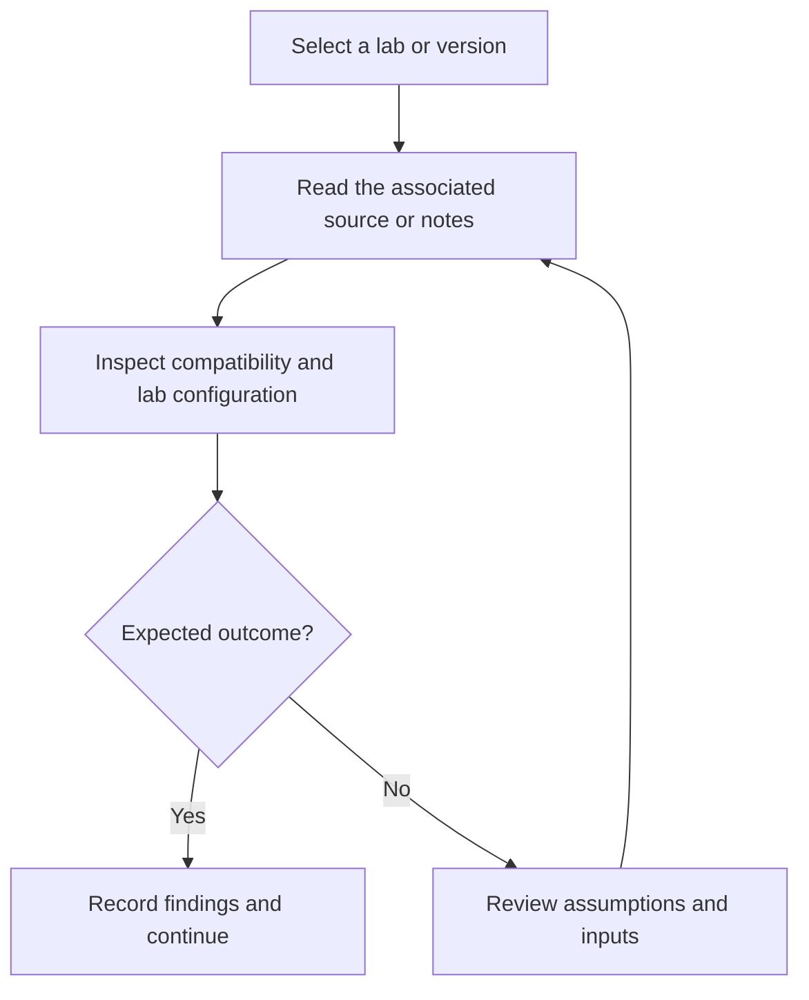

# GNS3 Routing and ACL Lab

GNS3 networking lab resources with a saved topology, routing and ACL guidance, shell commands, and an appliance definition.

## Project focus

Reference archive / lab resources. Use the directory map to choose a focused example or learning topic instead of treating the repository as one application.

## Workflow



The diagram describes how to work through the material; it is not a deployed service topology.

## Repository structure

| Path | Purpose |
| --- | --- |
| [`Corporate_Network_(EnvironmentSetup).pdf`](Corporate_Network_%28EnvironmentSetup%29.pdf) | Project-specific source, resources, or learning material. |
| [`LICENSE`](LICENSE) | Repository licensing terms. |
| [`alpine-linux.gns3a`](alpine-linux.gns3a) | GNS3 appliance definition. |
| [`commands.sh`](commands.sh) | Project-specific source, resources, or learning material. |
| [`requirements.txt`](requirements.txt) | Python dependency manifest. |
| [`static-Routing-Acl.gns3`](static-Routing-Acl.gns3) | Saved GNS3 topology. |

## Getting started

```bash
git clone https://github.com/Raimal-Raja/GNS3-Project-Guideline.git
cd GNS3-Project-Guideline
```

Browse the resource folders and associated notes first. This repository is not a Python web service and does not have a single application launch command.

Use GNS3 with compatible, correctly licensed appliances. Review the saved topology and routing/ACL notes before starting devices.

## Verification

Use the setup commands and inspect the selected interface, example, or notebook with known inputs. This documentation review checks repository paths and dependency declarations; it does not claim fresh end-to-end execution or model-quality measurements.

## Contributing

Include reproduction steps, the affected path, expected behavior, and the checks you ran. Keep credentials, generated environments, and unnecessary build artifacts out of commits.

## License

See [LICENSE](LICENSE) for the repository's license.
